# 1. Диаграмма прецедентов (Use Case Diagram)

## Акторы

| Актор | Тип | Описание |
|-------|-----|----------|
| Посетитель | Основной | Пользователь, желающий получить информацию о фильмах, сеансах и выбрать место |
| Кассир | Основной | Сотрудник, оформляющий и отменяющий продажу билетов |
| Администратор | Основной | Сотрудник, управляющий фильмами, кинозалами и расписанием |
| Контролёр | Основной | Сотрудник, проверяющий билеты по QR-коду |
| Система уведомлений | Внешний | Внешняя система, отправляющая уведомления (например, о статусе билета) |

## Прецеденты (Use Cases)

| ID | Прецедент | Актор-инициатор | Связь с требованиями | Краткое описание |
|----|-----------|-----------------|----------------------|------------------|
| UC-01 | Просмотреть список фильмов | Посетитель | FR-01, FR-02 | Посетитель просматривает список доступных фильмов с названием, описанием, жанром и возрастным ограничением |
| UC-02 | Просмотреть расписание сеансов | Посетитель | FR-03, FR-04 | Посетитель выбирает фильм и просматривает расписание сеансов с датой, временем, залом и стоимостью |
| UC-03 | Просмотреть схему мест | Посетитель | FR-05 | Система отображает схему мест выбранного сеанса с указанием занятых и свободных мест |
| UC-04 | Выбрать свободное место | Посетитель | FR-06 | Посетитель выбирает свободное место на выбранный сеанс |
| UC-05 | Оформить продажу билета | Кассир | FR-07, FR-08, FR-09 | Кассир оформляет продажу билета; система запрещает продажу занятого места и сохраняет информацию |
| UC-06 | Отменить билет | Кассир | FR-10 | Кассир отменяет билет до начала соответствующего сеанса |
| UC-07 | Управлять фильмами | Администратор | FR-11, FR-12 | Администратор добавляет, изменяет и удаляет информацию о фильмах |
| UC-08 | Управлять кинозалами | Администратор | FR-13 | Администратор добавляет и изменяет информацию о кинозалах |
| UC-09 | Управлять расписанием | Администратор | FR-14, FR-15 | Администратор создаёт, изменяет и удаляет сеансы; система запрещает пересекающиеся сеансы |
| UC-10 | Проверить билет по QR-коду | Контролёр | FR-16–FR-18 | Контролёр сканирует QR-код; система проверяет существование, соответствие сеансу и показывает данные |
| UC-11 | Проверить статус билета | Контролёр | FR-19–FR-21 | Система определяет статус (действителен / использован / отменён) и запрещает повторный проход |
| UC-12 | Просмотреть заполненность зала | Контролёр | FR-22, FR-24 | Контролёр просматривает текущую заполненность зала |
| UC-13 | Обновить информацию о местах | Система | FR-23 | Система автоматически обновляет занятость мест после успешной проверки билета |
| UC-14 | Авторизоваться | Все акторы | NFR-02, NFR-03 | Пользователь проходит авторизацию в соответствии со своей ролью |
| UC-15 | Отправить уведомление | Система уведомлений | — | Внешняя система отправляет уведомление о статусе билета или изменении расписания |

## Отношения «include» и «extend»

| Тип | Базовый прецедент | Связанный прецедент | Пояснение |
|-----|-------------------|---------------------|-----------|
| «include» | UC-05 Оформить продажу билета | UC-14 Авторизоваться | Кассир обязательно должен авторизоваться |
| «include» | UC-10 Проверить билет по QR-коду | UC-14 Авторизоваться | Контролёр обязательно должен авторизоваться |
| «include» | UC-11 Проверить статус билета | UC-10 Проверить билет по QR-коду | Проверка статуса всегда выполняется после сканирования |
| «extend» | UC-05 Оформить продажу билета | UC-06 Отменить билет | Отмена — необязательное действие после оформления |
| «extend» | UC-10 Проверить билет по QR-коду | UC-12 Просмотреть заполненность зала | После проверки контролёр может посмотреть заполненность |
| «extend» | UC-09 Управлять расписанием | UC-15 Отправить уведомление | При изменении расписания система может уведомить пользователей |