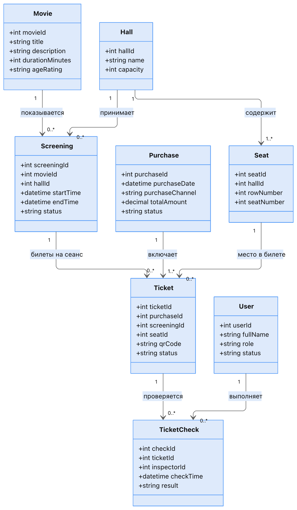

# 2. Модель предметной области

## Ключевые сущности

| Сущность | Тип | Ключевые атрибуты | Основные связи |
|----------|-----|-------------------|----------------|
| User | Базовая сущность | id, fullName, role, status | → TicketCheck (1:0..N) |
| Movie | Сущность | id, title, description, durationMinutes, ageRating | → Screening (1:0..N) |
| Hall | Сущность | id, name, capacity | → Seat (1:1..N), → Screening (1:0..N) |
| Seat | Сущность | id, hallId, rowNumber, seatNumber | → Hall (N:1), → Ticket (1:0..N) |
| Screening | Агрегатный корень | id, movieId, hallId, startTime, endTime, status | → Movie (N:1), → Hall (N:1), → Ticket (1:0..N) |
| Purchase | Сущность | id, purchaseDate, purchaseChannel, totalAmount, status | → Ticket (1:1..N) |
| Ticket | Агрегатный корень | id, purchaseId, screeningId, seatId, qrCode, status | → Screening (N:1), → Seat (N:1), → TicketCheck (1:0..N) |
| TicketCheck | Сущность | id, ticketId, inspectorId, checkTime, result | → Ticket (N:1), → User (N:1) |

## Кратности связей (основные)

| Связь | Кратность | Почему именно так |
|-------|-----------|-------------------|
| Movie → Screening | 1 : 0..N | У фильма может не быть сеансов или быть много |
| Hall → Seat | 1 : 1..N | В зале обязательно есть хотя бы одно место |
| Hall → Screening | 1 : 0..N | В зале может не быть сеансов |
| Screening → Ticket | 1 : 0..N | На новый сеанс ещё ничего не продано |
| Seat → Ticket | 1 : 0..N | Одно место продаётся на разные сеансы |
| Ticket → TicketCheck | 1 : 0..N | Хранится история проверок |
| User → TicketCheck | 1 : 0..N | Один контролёр делает много проверок |

## Value Objects и перечисления

- **Money** (amount, currency) — стоимость не может быть отрицательной
- **SeatNumber** (row, number) — обозначение места внутри зала
- **TicketStatus**: ACTIVE, CANCELLED, USED
- **ValidationResult**: VALID, ALREADY_USED, CANCELLED, NOT_FOUND, WRONG_SCREENING

## Ключевые бизнес-правила

1. **Запрет двойной продажи**  
   `UNIQUE (screening_id, seat_id)` для билетов со статусом ACTIVE.

2. **Запрет конфликтов расписания**  
   При создании/изменении сеанса вызывается проверка `checkTimeConflict(hallId, startTime, endTime)`.

3. **Атомарная проверка QR**  
   Одновременное сканирование одного и того же билета не должно разрешать два прохода (транзакция + блокировка).

4. **Разделение статусов**  
   Проданный билет (ACTIVE) ≠ прошедший контроль (USED). Отмена возможна только пока статус ACTIVE.