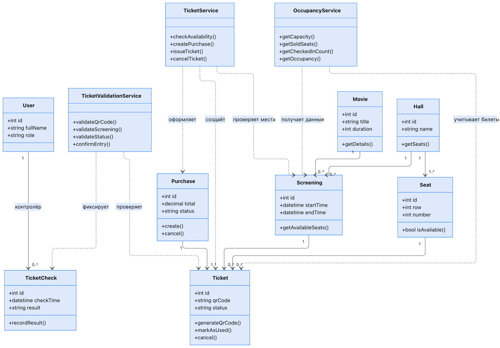

# 3. Диаграмма классов

## Основные классы и их ответственность

### Сервисный слой

| Класс | Методы | Назначение |
|-------|--------|------------|
| TicketService | checkAvailability(), createPurchase(), issueTicket(), cancelTicket() | Оформление и отмена билетов, проверка доступности мест |
| TicketValidationService | validateQrCode(), validateScreening(), validateStatus(), confirmEntry() | Проверка QR-кода и статуса билета |
| OccupancyService | getCapacity(), getSoldSeats(), getCheckedInCount(), getOccupancy() | Расчёт заполненности зала |

### Доменные сущности

| Класс | Ключевые методы | Назначение |
|-------|-----------------|------------|
| Ticket | generateQrCode(), markAsUsed(), cancel() | Жизненный цикл билета |
| Purchase | create(), cancel() | Группировка билетов одной покупки |
| Screening | getAvailableSeats() | Получение свободных мест на сеанс |
| Seat | isAvailable() | Проверка доступности конкретного места |
| TicketCheck | recordResult() | Фиксация результата проверки |

### Связи (основные)

- TicketService **оформляет** Purchase и **создаёт** Ticket
- TicketValidationService **проверяет** Ticket и **фиксирует** TicketCheck
- OccupancyService **учитывает** Ticket и **получает данные** из Screening / Hall
- User (роль «контролёр») **выполняет** TicketCheck

## Почему именно такая структура

- Разделение на **сервисы** и **доменные объекты** позволяет чётко отделить бизнес-логику от инфраструктуры.
- Ticket и Screening сделаны **агрегатными корнями** — все изменения статуса билета и доступности мест идут через них.
- Value Objects (Money, SeatNumber) защищают от некорректных данных.