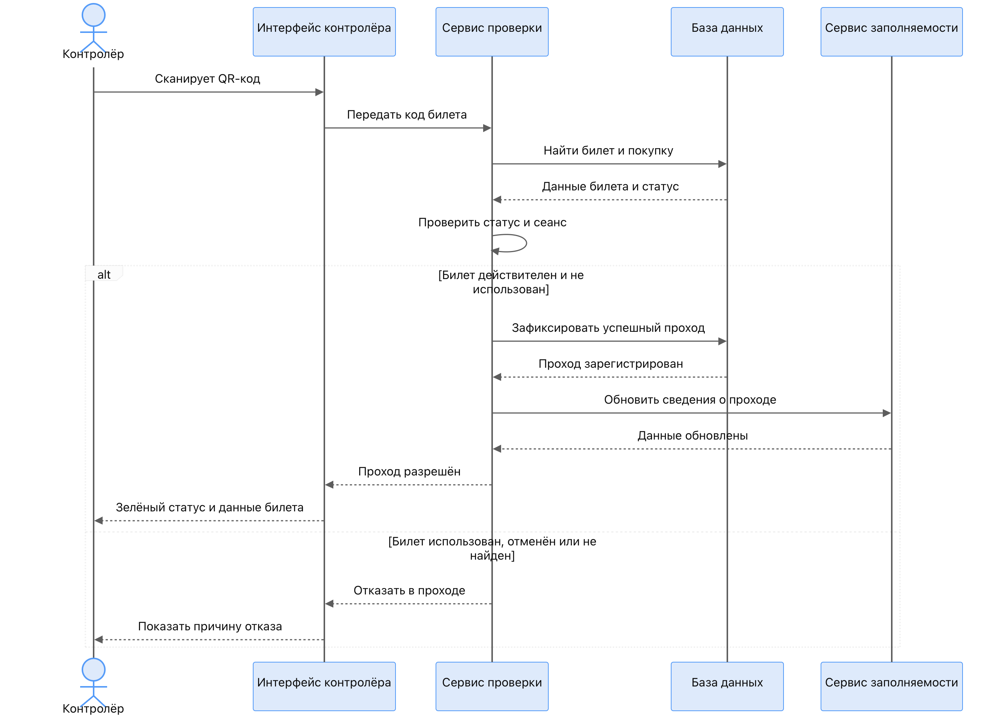
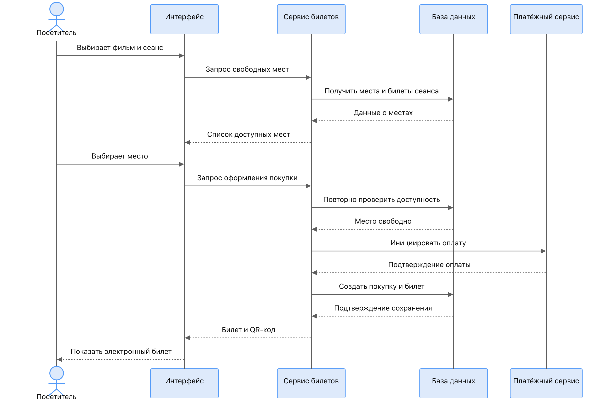

# 4. Диаграммы последовательности

## Сценарий 1. Проверка QR-билета контролёром

### Участники
- Контролёр
- Интерфейс контролёра
- Сервис проверки
- База данных
- Сервис заполняемости

### Основной поток (билет действителен)

1. Контролёр сканирует QR-код.
2. Интерфейс передаёт код билета в Сервис проверки.
3. Сервис находит билет и покупку в БД.
4. Получает данные билета и статус.
5. Проверяет статус и соответствие сеансу.
6. Фиксирует успешный проход в БД.
7. Обновляет сведения о заполняемости.
8. Возвращает «Проход разрешён» + данные билета (зелёный статус).

### Альтернативный поток (билет использован / отменён / не найден)

- Сервис проверки возвращает отказ.
- Интерфейс показывает причину отказа контролёру.

---

## Сценарий 2. Покупка билета (посетитель / кассир)

### Участники
- Посетитель
- Интерфейс
- Сервис билетов
- База данных
- Платёжный сервис (внешний)

### Основной поток

1. Посетитель выбирает фильм и сеанс.
2. Интерфейс запрашивает свободные места.
3. Сервис билетов получает места и билеты сеанса из БД.
4. Возвращает список доступных мест.
5. Посетитель выбирает место.
6. Интерфейс отправляет запрос оформления покупки.
7. Сервис **повторно** проверяет доступность места (защита от гонок).
8. Инициирует оплату через внешний платёжный сервис.
9. После подтверждения оплаты создаёт покупку и билет в БД.
10. Возвращает билет + QR-код.
11. Интерфейс показывает электронный билет посетителю.

### Важные моменты

- Повторная проверка доступности места — критична для NFR-04 (запрет двойной продажи).
- В MVP платёжный сервис можно заменить на заглушку (мок), если онлайн-оплата не требуется.