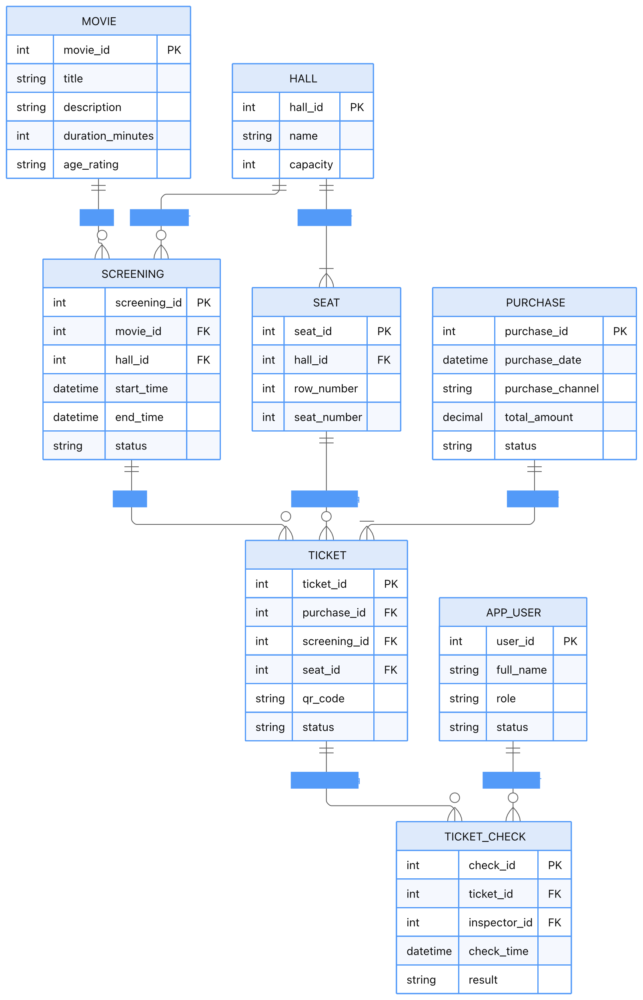

# 5. ER-диаграмма базы данных

## Таблицы

| Таблица | Основные поля | Первичный ключ | Внешние ключи |
|--------|---------------|----------------|---------------|
| MOVIE | movie_id, title, description, duration_minutes, age_rating | movie_id | — |
| HALL | hall_id, name, capacity | hall_id | — |
| SEAT | seat_id, hall_id, row_number, seat_number | seat_id | hall_id → HALL |
| SCREENING | screening_id, movie_id, hall_id, start_time, end_time, status | screening_id | movie_id → MOVIE, hall_id → HALL |
| PURCHASE | purchase_id, purchase_date, purchase_channel, total_amount, status | purchase_id | — |
| TICKET | ticket_id, purchase_id, screening_id, seat_id, qr_code, status | ticket_id | purchase_id, screening_id, seat_id |
| APP_USER | user_id, full_name, role, status | user_id | — |
| TICKET_CHECK | check_id, ticket_id, inspector_id, check_time, result | check_id | ticket_id → TICKET, inspector_id → APP_USER |

## Важные ограничения

1. **UNIQUE (screening_id, seat_id)** на таблице TICKET (для активных билетов) — защита от двойной продажи.
2. CHECK-ограничение: `end_time > start_time` в SCREENING.
3. Статус билета: только разрешённые значения (`ACTIVE`, `USED`, `CANCELLED`).
4. Индексы на `qr_code` и `(screening_id, seat_id)` для быстрого поиска.

## Связь ER ↔ Доменная модель

| Таблица БД | Доменный класс | Комментарий |
|-----------|----------------|-------------|
| MOVIE | Movie | Прямое соответствие |
| HALL | Hall | + capacity |
| SEAT | Seat | row + number |
| SCREENING | Screening | агрегатный корень |
| TICKET | Ticket | агрегатный корень |
| PURCHASE | Purchase | группирует билеты |
| TICKET_CHECK | TicketCheck | история проверок |
| APP_USER | User | роли через поле role |