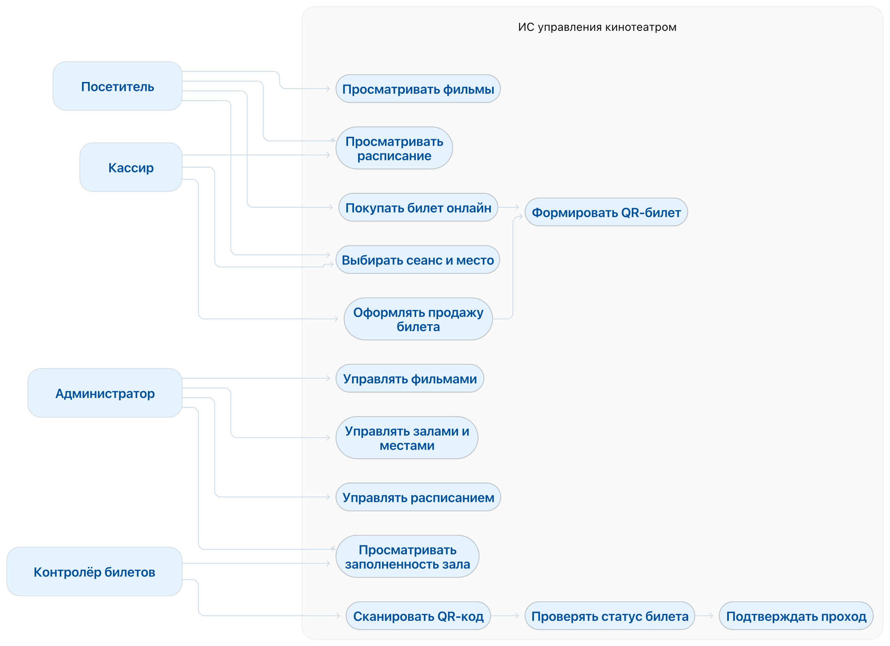

# 6. Архитектурный эскиз

## Уровни архитектуры

### 1. Клиентский уровень
- Интерфейс посетителя
- Интерфейс кассира
- Интерфейс администратора
- Интерфейс контролёра

### 2. Серверный уровень (монолит)
- **API** — единая точка взаимодействия (REST)
- Сервис авторизации и ролей
- Сервис фильмов и расписания
- Сервис проверки QR-кодов
- Сервис покупок и билетов
- Сервис заполняемости

### 3. Уровень хранения данных
- База данных кинотеатра (PostgreSQL / MySQL)

### 4. Внешние системы
- Внешний платёжный сервис (в MVP — заглушка)

## Почему выбран монолит, а не микросервисы

| Критерий | Монолит | Микросервисы |
|----------|---------|--------------|
| Размер команды | 2–3 человека | нужна большая команда |
| Срок | 4 спринта | долго настраивать инфраструктуру |
| Нагрузка | до 100 одновременных пользователей | оправдано при высокой нагрузке |
| Транзакции | простые (продажа + проверка места) | распределённые транзакции сложны |
| Развёртывание | одно приложение | service discovery, gateway, мониторинг |

**Вывод:** для учебного проекта и небольшого кинотеатра монолит — оптимальный выбор.  
При этом код уже разделён на **слои** (контроллеры → сервисы → репозитории) и **модули** (фильмы, сеансы, билеты, проверка). Если проект вырастет, отдельные модули можно будет выделить в сервисы без полной переписки.